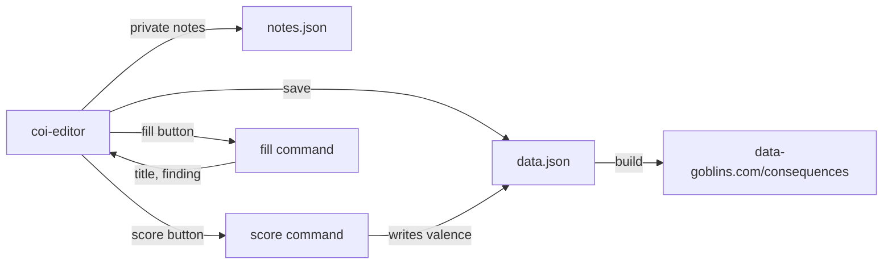

# coi-editor

Desktop editor for the consequences in `data.json`.



## Run

```sh
cargo run --release
cargo run --release -- path/to/coi-editor.config.yaml
```

The editor reads `~/.config/coi-editor/coi-editor.config.yaml` when you give no path. Without a config file, it edits `../data.json` and keeps notes in `~/.local/share/coi-editor/notes.json`.

## Config

```yaml
data: ~/git/consequences-of-intelligence/data.json
notes: ~/.local/share/coi-editor/notes.json
score:
  label: Score
  command: [python3, score.py, "{ids}"]
  cwd: ~/path/to/scorer
fill:
  label: Fill
  command: [python3, fill_ref.py]
  cwd: ~/path/to/filler
```

- `{ids}` expands to the ids you changed since the last score, or to the selected id
- The score command gets the data path in `COI_DATA`
- The editor saves before it runs the command and reloads the file after
- The fill command gets `{"url", "label", "summary"}` as JSON on stdin and prints `{"title", "finding"}` as JSON; `{url}` in `command` expands to the link
- The editor fills only empty fields, so a fill never overwrites your text

## Use

- Select a consequence in the list, or add one with New
- Drag the sliders to set valence, probability and when; the left end of When is "already here"
- Edit the id and press Enter to rename it; links, `price_of` and `merged` follow the new id
- Paste a link into a new reference and press Enter to fill its title and finding, or use Fill
- Save with Ctrl+S
- When `data.json` changes on disk, the editor does not overwrite it; use Reload
